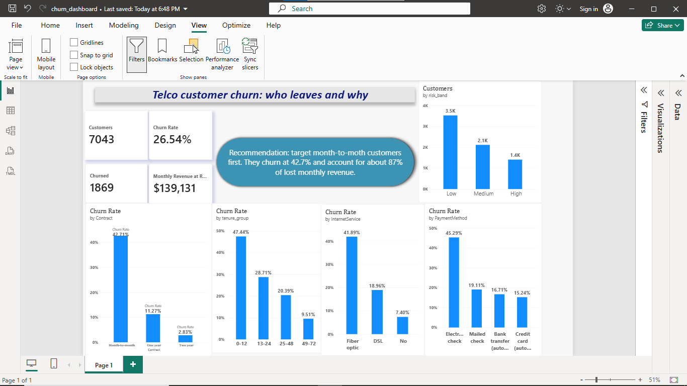

# Telco Customer Churn: Analysis and Prediction

## Business question
Which customers are likely to leave, why, and what should the company do?

## Data
Kaggle Telco Customer Churn dataset: 7,043 customers, 21 columns. Churn rate: 26.54%.

## Tools
Python (pandas, scipy, statsmodels, scikit-learn), SQL (MySQL), Power BI

## Method
1. Cleaning: 11 blank TotalCharges (new customers, tenure 0) filled with 0; no duplicates.
2. EDA and SQL: churn by contract, internet service, payment method, tenure; revenue lost to churn.
3. Statistics: chi-square tests with Cramer's V, Welch t-tests with Cohen's d, confidence interval for the contract gap.
4. Models: logistic regression and random forest (class-balanced), 5-fold cross-validation.
5. Dashboard: Power BI with KPIs, churn by segment, and customer risk bands.

## Key findings
- Month-to-month churn: 42.71%, vs 2.83% on two-year contracts (gap 38.1 to 41.6 points, 95% CI).
- Month-to-month customers account for about 87% of monthly revenue lost to churn ($120.8K of $139.1K).
- Fiber optic churn: 41.89%. Electronic check churn: 45.29%.
- Churned customers: shorter tenure (18 vs 38 months, d = -0.89) and higher monthly charges ($74 vs $61, d = 0.47).
- Gender is not linked to churn (p = 0.49).
- Highest-risk segment (month-to-month, fiber optic, electronic check): 1,307 customers, 60.4% churn.

## Models
| Model | Precision (churn) | Recall (churn) | ROC-AUC |
|---|---|---|---|
| Logistic regression (balanced) | 0.504 | 0.783 | 0.842 |
| Random forest (balanced) | 0.518 | 0.802 | 0.845 |

5-fold CV ROC-AUC: logistic 0.845 +/- 0.013, random forest 0.847 +/- 0.012 (a tie). I chose logistic regression because it is explainable (fiber optic odds ratio 3.40, two-year contract 0.24).
Data leakage note: my first model scored 100%. I traced it to a mis-typed column name that kept the target in the features, fixed it, and got a realistic ROC-AUC of 0.84.

## Recommendations
1. Focus retention on month-to-month customers.
2. Offer discounts to move customers to yearly contracts.
3. Bundle online security and tech support (odds ratios 0.72 and 0.76).
4. Encourage automatic payment instead of electronic check.
5. Contact the top 20% riskiest customers first: they hold 49.7% of churners. An illustrative campaign (assumptions: $20 per offer, 30% success, 12 months saved) gives a net benefit of $44,226 on the test set.
6. Run an A/B test on any offer before rolling it out.

## Limitations
Associations, not causes. The business case rests on assumed costs. One dataset, no time dimension.

## Files
- `churn_analysis.ipynb`: Python analysis
- `churn_queries.sql`: SQL queries
- `churn_dashboard.pbix`: Power BI file
- `churn_dashboard.png`: dashboard screenshot

## Dashboard

